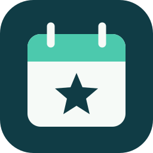

# Kai ChatGPT Plugins

Tools and reusable workflows for completing everyday tasks through ChatGPT / Codex conversations.

[简体中文](README.md) · [GitHub repository](https://github.com/kmjskai/kai-chatgpt-plugins) · [Report an issue](https://github.com/kmjskai/kai-chatgpt-plugins/issues)

## Plugins

| Plugin | Features | Platform |
| --- | --- | --- |
| [Kai iCloud Calendar](plugins/kai-icloud-calendar/README.en.md) | List calendars, find events, and create one explicitly confirmed event | Local macOS execution |

## Install and get started

Use a Codex client that supports local plugin marketplaces and local MCP servers. Obtain the complete directory, then run these commands from its root:

```sh
codex plugin marketplace add .
codex plugin add kai-icloud-calendar@kai-chatgpt-plugins
```

Start a new local conversation in the desktop client, select **Kai iCloud Calendar**, and ask:

> List my calendars and show my events for the next seven days.

If the list has not refreshed, refresh the marketplace or reopen the client. Installation does not require an Apple password.

## Requirements and permissions

- macOS 14 or later on Apple Silicon; the bundled helper currently supports arm64 only.
- Node.js 20 or later, with `node` on the client's PATH.
- Calendar accounts configured and synchronized in macOS Calendar.
- Full Calendar access for **Kai Apple Calendar Helper**, granted when prompted on first use.

The plugin runs in local Mac conversations. Mobile and browser-only conversations cannot run the helper directly. The helper targets macOS 14. Reads have been verified on two Apple Silicon Macs running macOS 27.0.1, with event creation and readback verified on one. Testing on an actual macOS 14 device is still pending.

## Update, uninstall, and recover

After updating the marketplace, reinstall the plugin and start a new conversation. Keep the complete previous version if you need to roll back.

```sh
codex plugin remove kai-icloud-calendar@kai-chatgpt-plugins
codex plugin marketplace remove kai-chatgpt-plugins
```

Uninstalling does not delete calendars or events and does not revoke system permission automatically. Manage access in System Settings → Privacy & Security → Calendars. Check synchronization in macOS Calendar first if data is missing.

## Data, networking, and privacy

The calendar plugin uses EventKit to access the local calendar store. It does not sign in to iCloud or operate a separate cloud service. It can access iCloud and other accounts exposed by EventKit.

Requested content is returned to the AI client and follows its data policies. The plugin does not maintain additional calendar-content logs or analytics. System synchronization, client communication, and signature checks may use the network.

## Limitations and feedback

The plugin reads events and creates individual non-recurring events. It does not update or delete events, or create repeating series. Confirm details before creation. If a write has an unclear outcome, search for the event before retrying.

When reporting an issue to the provider, include client, macOS, and plugin versions and the error message. Do not include passwords, access tokens, or complete private schedules.

## Build from source

The package includes MCP and Swift helper source. Install Xcode Command Line Tools and follow the [build instructions](docs/building.md). A Swift compiler is not needed for normal use.

## License

Original code, documentation, configuration, and the bundled calendar Skill use the [Apache License 2.0](LICENSE). See [NOTICE](NOTICE) for attribution and licensing.
